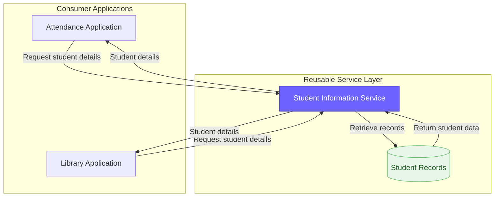

<div align="center">

# 🎓 Student Information SOA

### One reusable service. Two independent applications. One consistent source of student information.

A Service-Oriented Architecture (SOA) project demonstrating how a centralized **Student Information Service** can be consumed by two independent applications: an **Attendance Management Application** and a **Library Management Application**.

The objective is to identify reusable business functionality, define a service interface, and demonstrate how different applications can access the same service instead of duplicating student information retrieval logic.

<br/>


**Academic Project | Service-Oriented Architecture**

</div>

---

## 📌 Problem Statement

In a college environment, different applications often require access to the same student information.

For example, an attendance system needs student details before recording attendance, while a library management system needs the same details when processing book issues and returns.

If each application independently implements student information retrieval, the same functionality may be duplicated across multiple systems.

This can lead to:

| Problem | Impact |
|---|---|
| 🔁 Duplicate functionality | Each application implements similar student retrieval logic. |
| ⚠️ Inconsistent information | Separate student records may become outdated or inconsistent. |
| 🛠️ Difficult maintenance | Changes to student information handling may need to be repeated across applications. |
| 🚫 Limited reusability | Functionality developed for one application is not easily shared with another. |

**Objective:** Design a reusable Student Information Service and demonstrate how two independent applications can consume the same service through a common interface.

---

## 💡 The Solution

Instead of implementing student information retrieval separately in each application, this project introduces a shared **Student Information Service**.

The service provides student details through a proposed REST API. Both consuming applications request information from this common service.

### The three components

| Component | Responsibility |
|---|---|
| 🎓 **Student Information Service** | Provides student details through a reusable API. |
| 📋 **Attendance Application** | Retrieves student details and displays them alongside attendance information. |
| 📚 **Library Application** | Retrieves the same student details and displays them alongside library information. |

### Example scenario

Consider a student with the ID `STU1024`.

1. The Attendance Application requests the student's details.
2. The Student Information Service returns the student's name, department, and academic year.
3. The Library Application requests the same student's details through the same service.
4. Both applications receive student information from the common source.

The student information retrieval functionality is implemented once in the service design and made available to multiple consumers.

> **Core SOA concept:** Build a business capability once and expose it through a well-defined interface so that multiple applications can reuse it.

---

## 🏗️ Architecture

The proposed architecture separates the shared student information functionality from the applications that consume it.



### Architecture components

| Component | Role |
|---|---|
| Attendance Application | Consumer that retrieves student information for attendance-related operations. |
| Library Application | Consumer that retrieves student information for library-related operations. |
| Student Information Service | Shared service responsible for exposing student information through a defined interface. |
| Student Records | Represents the data source used by the service. |

The diagram illustrates the proposed logical architecture. The implementation details will be documented separately from the architecture model.

---

## 🔄 How It Works

### 1. Attendance Application consumes the service

The Attendance Application sends a request containing a student ID to the Student Information Service.

The service retrieves the corresponding student record and returns the information to the application.

The application can then display the student's details alongside attendance information.

### 2. Library Application consumes the same service

The Library Application sends a request to the same Student Information Service.

It receives the same student's details and can use them when displaying library information or processing library operations.

### 3. One service, multiple consumers

Both applications use the same service interface.

This avoids the need for each application to implement its own student information retrieval functionality and demonstrates the principle of service reusability.

---

## 📡 Proposed Service API

The Student Information Service is designed around a simple REST endpoint.

| Property | Specification |
|---|---|
| Service name | Student Information Service |
| HTTP method | `GET` |
| Endpoint | `/api/students/{studentId}` |
| Input | Student ID |
| Response format | JSON |
| Consumers | Attendance Application and Library Application |

### Example request

```http
GET /api/students/STU1024
```

### Example response

```json
{
  "studentId": "STU1024",
  "name": "Ananya Sharma",
  "department": "Computer Science",
  "year": 3
}
```

The example illustrates the proposed API contract and sample response structure.

---

## 🧩 SOA Principles Demonstrated

| Principle | Application in this project |
|---|---|
| **Service Reusability** | Both applications consume the same Student Information Service. |
| **Loose Coupling** | Applications interact through a defined service interface rather than depending on each other's internal implementation. |
| **Service Abstraction** | Consumers do not need to know how the service retrieves student records internally. |
| **Service Autonomy** | Student information retrieval is assigned to a dedicated service with a defined responsibility. |
| **Interoperability** | A REST interface with JSON responses provides a standard way for different applications to communicate. |
| **Separation of Concerns** | Student information retrieval is separated from attendance and library business functionality. |

---

## 🛠️ Technology Stack

The proposed implementation uses lightweight web technologies to keep the project simple and easy to understand.

| Technology | Purpose |
|---|---|
| Node.js | Runs the backend service. |
| Express.js | Defines the REST API endpoints. |
| JavaScript | Implements service logic and consumer-side interactions. |
| HTML | Structures the two application interfaces. |
| CSS | Styles the application interfaces. |
| JSON | Represents student records and API responses. |

---

## 📁 Project Structure

The repository is organized around the reusable service, its two consumer applications, and the accompanying documentation.

```text
student-information-soa/
│
├── README.md
├── service-identification.md
├── soa-architecture.md
│
├── student-service/
│   ├── server.js
│   └── students.json
│
├── attendance-app/
│   ├── index.html
│   ├── style.css
│   └── app.js
│
└── library-app/
    ├── index.html
    ├── style.css
    └── app.js
```

The application files will be added as the implementation progresses.

---

## 📚 Project Documentation

| Document | Description |
|---|---|
| [Service Identification and Analysis](service-identification.md) | Describes the identified services, their responsibilities, consumers, and reusability. |
| [SOA Architecture and Interaction Modeling](soa-architecture.md) | Presents the architecture and sequence diagrams illustrating service interactions. |

---

## 🎯 Expected Outcomes

The project aims to demonstrate:

- Identification of a reusable business service.
- Definition of a service interface using a REST API.
- Consumption of a common service by two different applications.
- Reduction of duplicated student information retrieval functionality.
- Application of core SOA principles through service modeling.

---

## 🔭 Future Scope

The proposed system could be extended with:

- Database integration for persistent student records.
- Authentication and authorization for service consumers.
- Additional applications, such as examination management and student portals.
- Input validation and standardized API error handling.
- Automated tests for the service and its consumers.
- Deployment to a cloud platform.

---

## 📝 Conclusion

This project explores the application of Service-Oriented Architecture to a college management scenario.

By separating student information retrieval into a dedicated service, the Attendance Application and Library Application can reuse a common business capability through a defined interface.

The project demonstrates how service identification, reusability, abstraction, and loose coupling can support the design of modular and maintainable software systems.

</div>