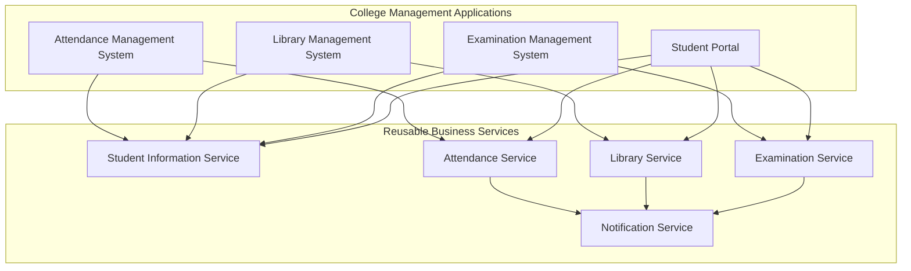
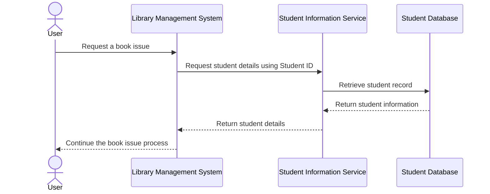

# SOA Architecture and Interaction Modeling

## 1. Overview

This document presents the proposed Service-Oriented Architecture (SOA) for a college management system.

The architecture separates application interfaces from business services. Each application consumes the services required for its operations, while reusable services provide shared functionality through well-defined interfaces.

## 2. SOA Architecture Diagram

The following diagram illustrates how different college applications interact with the identified services.

### Diagram explanation

- **Applications layer:** Contains the attendance system, library management system, examination system, and student portal.
- **Service layer:** Contains independent services responsible for specific business capabilities.
- **Service reuse:** The Student Information Service is consumed by all four applications.
- **Service interaction:** The Attendance, Library, and Examination Services can use the Notification Service to send relevant notifications.

The diagram illustrates logical service relationships rather than a deployed implementation.

## 3. Student Information Service Interaction

The following sequence diagram illustrates how the Library Management System retrieves student information through the Student Information Service.

### Sequence diagram explanation

1. A user initiates a book issue request through the Library Management System.
2. The Library Management System requests the student's details from the Student Information Service.
3. The Student Information Service retrieves the student record from the database.
4. The database returns the requested information to the service.
5. The service returns the student details to the Library Management System.
6. The Library Management System uses the returned information to continue processing the request.

This interaction demonstrates service abstraction: the Library Management System requests student information through the service interface without directly accessing the student database.

## 4. SOA Modeling Observations

The architecture demonstrates the following principles:

- **Reusability:** A common student information service supports multiple applications.
- **Loose coupling:** Applications interact with services through defined interfaces.
- **Abstraction:** Consumers do not need to know how a service internally retrieves information.
- **Separation of concerns:** Each service has a distinct business responsibility.
- **Composability:** Multiple services can work together to support a larger business process.

## 5. Conclusion

The proposed SOA model organizes college management functionality into reusable business services. The architecture and sequence diagrams demonstrate how applications consume these services and how a shared Student Information Service reduces duplicated functionality.

The model provides a foundation for integrating additional college applications through well-defined service interfaces.